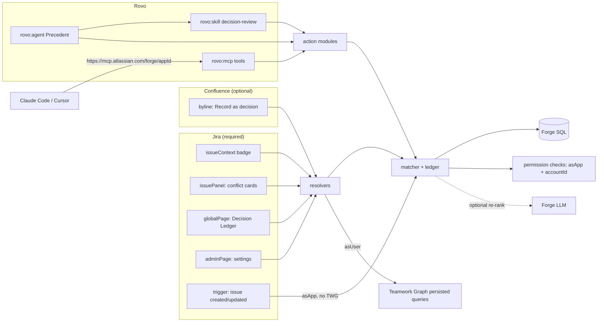

# Precedent

**Decision memory that catches conflicting work early.**

Teams make decisions in Confluence pages, Jira comments and meetings, then forget them. Months later someone starts work that contradicts a decision, or argues it all over again. Precedent keeps a structured **Decision Ledger**, links each decision to the work, people and goals around it through **Teamwork Graph**, and flags conflicts when new work is created: in Jira, in Rovo chat, and in developers' own AI coding tools through **MCP**.

> Status: **M1 to M8 built** (Decision Ledger, conflict checks in Jira, Rovo agent actions and MCP tools, Teamwork Graph context, Confluence capture, admin settings). Remaining: M9 Marketplace packaging. See [DECISIONS.md](DECISIONS.md) for the design log.

## Architecture



## Repository layout

| Path | Purpose |
|------|---------|
| `manifest.yml` | Forge modules and scopes |
| `src/index.ts` | Function entry points |
| `src/db/` | Forge SQL schema and migration orchestration |
| `src/permissions/` | Caller visibility checks (fail closed) |
| `src/actions/` | Rovo actions / MCP tools behind the auth guard |
| `src/resolvers/` | UI Kit resolvers |
| `src/triggers/` | Jira event trigger and issue-context badge |
| `src/frontend/` | UI Kit surfaces |
| `src/rovo/prompt.md` | Agent prompt |
| `skills/decision-review/` | Rovo skill |
| `test/` | Jest unit tests |

## Setup

Requirements: Node 24 (`nvm use`), Forge CLI 15+, an Atlassian site with Jira, Confluence and Rovo, and membership of the app's Developer Space. The project's dev and demo site is a Forge demo site (`forge site provision`), which includes Rovo.

```bash
npm install
npm run ci                       # typecheck + jest + forge lint
forge deploy -e development
forge install -e development --site <site>.atlassian.net --product jira
forge install -e development --site <site>.atlassian.net --product confluence
```

Credentials: `forge login`, or `FORGE_EMAIL` / `FORGE_API_TOKEN` in a local `.env` (git-ignored).

After installing, a Jira admin can open any work item → **•••** next to the Precedent panel → **Show for all work items** so the detail panel is always visible. The sidebar badge (`jira:issueContext`) needs no configuration.

## Scopes (17) and why each is needed

| Scope | Why |
|-------|-----|
| `read:jira-work` | Read issue summary and description for conflict checks; receive issue created/updated events |
| `write:jira-work` | Add the single opt-in conflict comment and `precedent:conflict` label; notify the owner on revisit |
| `read:jira-user` | Show decision owners' names and avatars |
| `read:permission:jira` | Check that the caller can browse a decision's source issue before returning it (needed for MCP calls, which run as the app) |
| `read:page:confluence` | Pre-fill "Record as decision" from the page title and body |
| `read:confluence-content.permission` | Check that the caller can read a decision's source page before returning it |
| `read:chat:rovo` | Let customer-built agents (Rovo Studio, `rovo:mcp`) use Precedent's actions |
| `read:graph:issue:jira` | Teamwork Graph: work items linked to a decision or the current issue |
| `read:graph:issue-comment:jira` | Teamwork Graph: decisions made in issue comments |
| `read:graph:project:jira` | Teamwork Graph: the Jira project around the work |
| `read:graph:page:confluence` | Teamwork Graph: decision source pages and their contributors |
| `read:graph:comment:confluence` | Teamwork Graph: discussion on decision pages |
| `read:graph:space:confluence` | Teamwork Graph: the space a decision page lives in |
| `read:graph:user:atlassian` | Teamwork Graph: owners, contributors and "who to ask" suggestions |
| `read:graph:team:atlassian` | Teamwork Graph: the teams tied to a decision or goal |
| `read:graph:goal:atlassian` | Teamwork Graph: goals the related work contributes to |
| `read:graph:project:atlassian` | Teamwork Graph: Atlassian projects that contribute to those goals |

Forge SQL and Forge LLM need no scopes. Teamwork Graph scopes are read-only, and an admin can switch any of them off. Precedent then shows "graph context unavailable" and keeps working.

## Security model

- **Every action requires `context.accountId`.** Calls without one are rejected before any logic runs. Account ids in inputs are ignored.
- **MCP tools run as the app** (`asUser()` is unreliable from third-party MCP clients). Before returning a decision, Precedent checks that the caller can view **every** source it cites (Jira bulk permissions, Confluence content permission check). Errors fail closed.
- **Triggers** run as the app and never call Teamwork Graph.
- Tests: `test/access.test.ts`, `test/guard.test.ts`.

## Connecting a coding agent (MCP)

1. A site or org admin opens **Atlassian Administration → Apps → Sites → *site* → Connected apps → Precedent → Tools** and turns on the tools to expose (off by default).
2. Add the server to your client:
   ```bash
   claude mcp add --transport http precedent https://mcp.atlassian.com/forge/3fa13916-697c-4de7-ad17-9aa259ca2d67
   ```
3. Run `/mcp`, then complete OAuth and choose the site.

Exposed tools: `find-precedent`, `check-conflict`, `get-decision-context`, `record-decision`.

## Marketplace and judge installation

- **One app, one listing.** Precedent is a single Forge app that requires Jira and connects to Confluence optionally. Marketplace reads compatibility from the manifest. Admins install it into Jira and can connect Confluence during installation. Cross-product calls (for example `requestConfluence` from Jira-triggered code) work once both products are connected. Multi-product apps can only be listed as **paid** apps.
- **Install link vs Marketplace.** An app that has `licensing` in its manifest, or has been submitted to Marketplace, **cannot be shared through an install link**. Judges therefore install a separate, unlicensed copy of the same code ("Precedent – Judges", its own app id, distribution set to *Sharing*). Its install link keeps working regardless of the Marketplace review. The judge site must have both Jira and Confluence.

Test account notes: *added in M9.*
